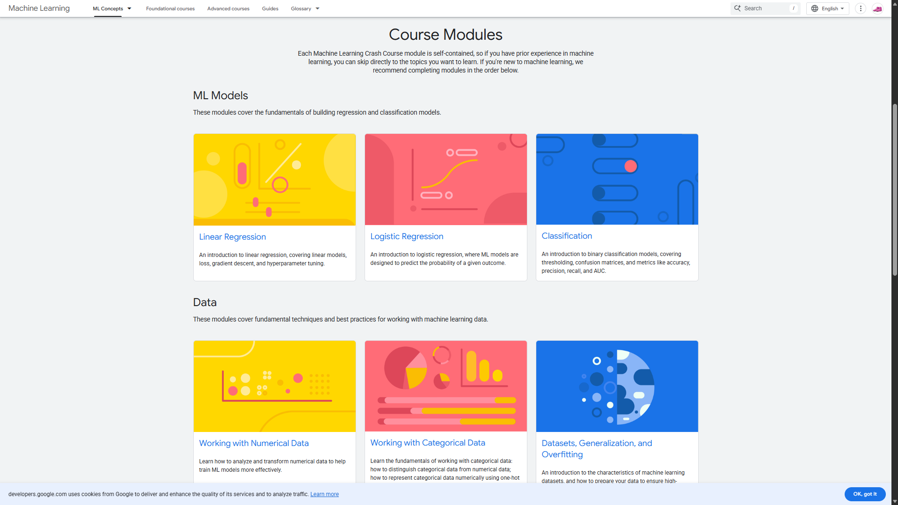
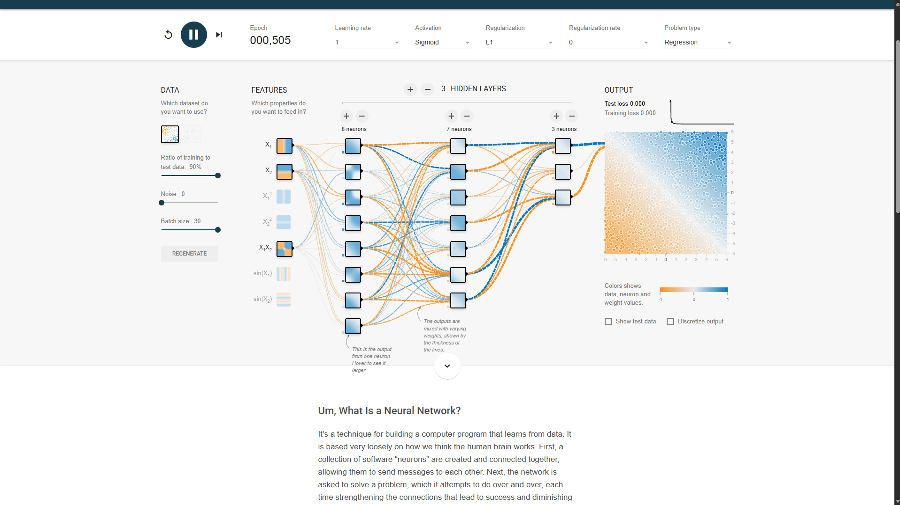
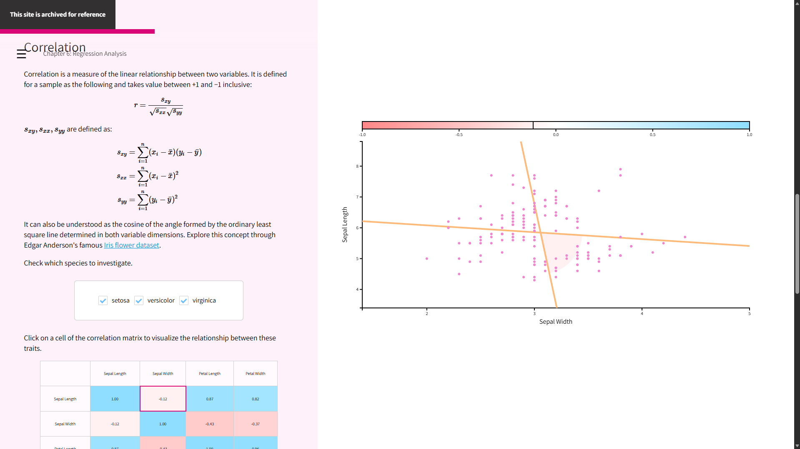
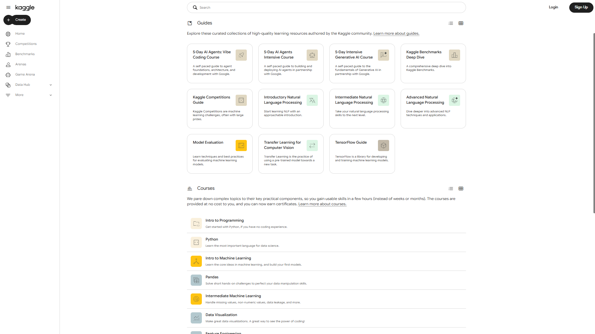
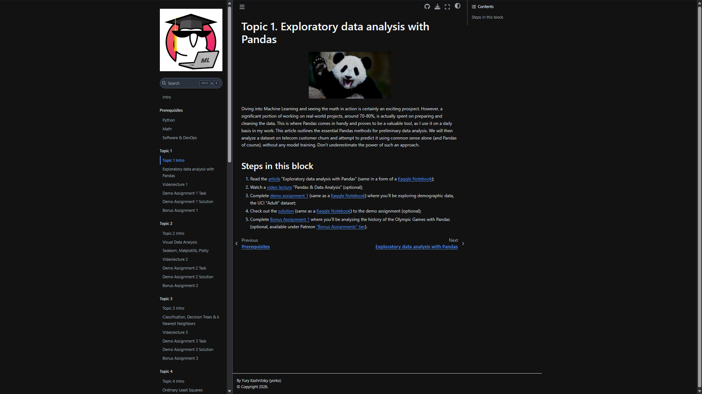
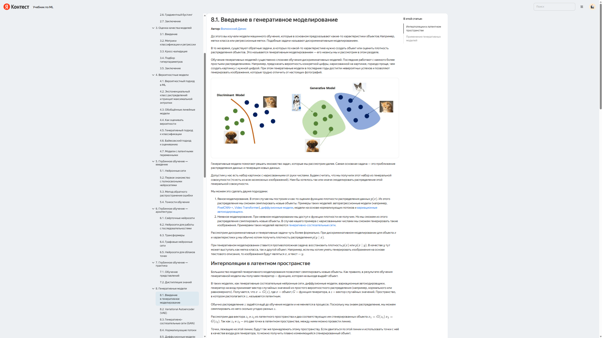
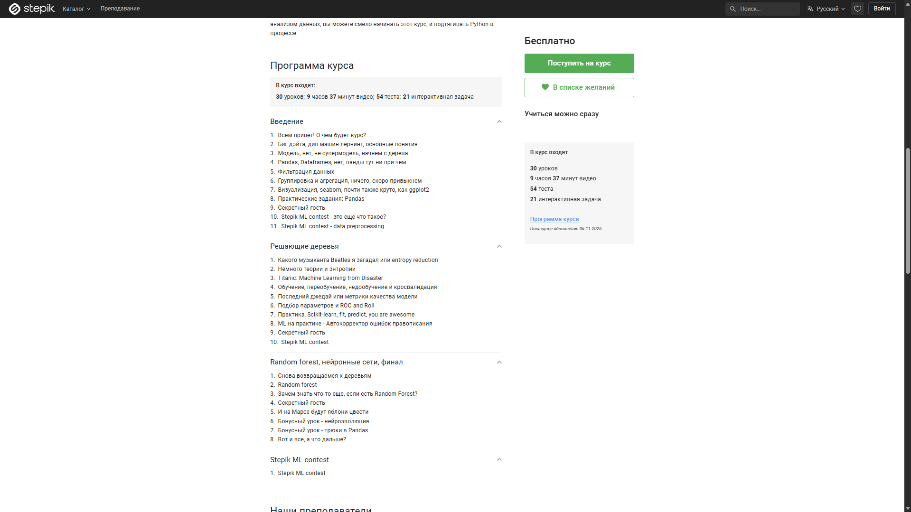

Актуальность
Машинное обучение активно используется в разных сферах, поэтому важно не только знать основные алгоритмы, но и понимать, как они работают на практике. Однако некоторые темы довольно сложно изучать только по лекциям и учебникам, например, не всегда понятно, как работает градиентный спуск, или как количество соседей влияет на результат алгоритма kNN и как изменение параметров модели отражается на её точности. Интерактивные демонстрации помогают лучше разобраться в таких темах. Человек может самостоятельно менять параметры алгоритмов и сразу видеть результат на графиках. Такой подход используется в TensorFlow Playground и Google Machine Learning Crash Course. Существуют и другие полезные ресурсы для изучения машинного обучения - учебник Яндекса и mlcourse.ai, например. Однако у каждого из них свои особенности: одни больше ориентированы на теорию, другие предлагают практические задания, а некоторые материалы доступны преимущественно только на английском языке. Поэтому актуальна разработка русскоязычного учебного веб-ресурса, который будет связан с программой конкретной дисциплины. В нём планируется объединить теоретические материалы, интерактивные демонстрации и возможность работать с собственными данными. Это позволит студентам не только изучать алгоритмы, но и сразу проверять полученные знания на практике.

## Обзор аналогов

Перед разработкой проекта были рассмотрены существующие образовательные ресурсы по машинному обучению. Для сравнения выбраны семь сайтов, которые предлагают теоретические материалы, интерактивные демонстрации или практические задания.

### Сравнение существующих решений

| Ресурс | Язык | Теория и формулы | Интерактивные демонстрации | Свои данные | Автопроверка | Материалы преподавателя | Доступ |
|---|---|---|---|---|---|---|---|
| [Google ML Crash Course](https://developers.google.com/machine-learning/crash-course) | Английский | Да | Регрессия, классификация, нейросети | Через практические ноутбуки | Да, тесты и упражнения | Нет, курс фиксированный | Бесплатно, для отдельных упражнений нужен Google-аккаунт |
| [TensorFlow Playground](https://playground.tensorflow.org/) | Английский | Краткие пояснения | Нейронные сети, классификация и регрессия | Нет, встроенные наборы | Нет | Нет | Бесплатно, без регистрации, код Apache 2.0 |
| [Seeing Theory](https://seeing-theory.brown.edu/) | Английский и другие языки, кроме русского | Да | Вероятность, распределения, статистика, регрессия | Нет | Нет | Нет | Бесплатно, без регистрации, исходный код Apache 2.0 |
| [Kaggle Learn](https://www.kaggle.com/learn) | Английский | Да, преимущественно краткая теория | Практика с кодом и моделями в ноутбуках | Да, через Kaggle Notebooks | Да | Нет, нельзя менять готовые курсы | Бесплатно, нужен аккаунт для практики |
| [mlcourse.ai](https://mlcourse.ai/) | Английский, есть русскоязычные материалы | Да | Примеры и графики в Jupyter Notebook | Да, через ноутбуки | Есть практические задания, без единой встроенной системы проверки | Нет, не через интерфейс курса | Основные материалы открыты, условия использования определяются лицензией репозитория |
| [Учебник ШАД Яндекса](https://education.yandex.ru/handbook/ml) | Русский | Да, подробно | В основном графики и примеры, без единой системы изменения параметров | Нет встроенной песочницы | Нет единой системы автопроверки в учебнике | Нет | Бесплатно, чтение без регистрации |
| [Stepik: Введение в Data Science и машинное обучение](https://stepik.org/course/4852) | Русский | Да | Практические задания, без отдельного общего симулятора алгоритмов | Не предусмотрена встроенная CSV-песочница этого курса | Да, задания на платформе | Да, авторы могут создавать собственные курсы на Stepik | Курс бесплатный, для прохождения нужна регистрация |

### Выводы по аналогам

**1. Google Machine Learning Crash Course**

Google Machine Learning Crash Course хорошо подходит для изучения основ машинного обучения. В нём есть теория, иллюстрации и практические упражнения, но материалы преимущественно на английском языке, могут быть проблемы для тех, кто плохо знает английский язык.

**2. TensorFlow Playground**

Этот ресурс позволяет менять параметры нейронной сети и сразу наблюдать за её обучением. Понравилась возможность видеть изменения на графиках, но сайт посвящён в основном нейросетям и не позволяет условно загрузить собственный CSV-файл.

**3. Seeing Theory**

Сайт наглядно объясняет вероятность и статистику с помощью интерактивных графиков. Его удобно использовать для понимания математических основ, однако он не является полноценным курсом по машинному обучению.

**4. Kaggle Learn**

Kaggle Learn позволяет изучать машинное обучение на практике, выполняя задания с кодом. Его преимущество — работа с реальными данными, для начинающих пользователей такой формат может быть сложнее обычной демонстрации с ползунками.

**5. mlcourse.ai**

Здесь собрано много теоретических материалов, примеров и практических заданий по машинному обучению. Курс достаточно подробный, но для работы с алгоритмами часто требуется самостоятельно разбираться в Python и Jupyter Notebook.

**6. Учебник по машинному обучению ШАД Яндекса**

Учебник содержит подробные объяснения алгоритмов на русском языке, формулы и примеры. Это хороший источник теории, однако в нём нет общей песочницы, где пользователь мог бы загрузить свои данные и поэкспериментировать с моделями через простой интерфейс.

**7. Stepik: Введение в Data Science и машинное обучение**

Курс Stepik удобен тем, что теория дополняется практическими заданиями с проверкой ответов, при этом он не предлагает единую интерактивную среду, в которой можно свободно менять параметры разных моделей и наблюдать изменения графиков.

### Итог сравнения

При изучении аналогов мне понравилось несколько решений, которые, я бы добавил в свой проект, например, от TensorFlow Playground я бы взял идею изменения параметров алгоритмов с помощью ползунков, от Kaggle — работу с данными, а от Stepik — практические задания с автоматической проверкой. Главное отличие разрабатываемого ресурса будет в том, что он объединит эти возможности на одном русскоязычном сайте.

